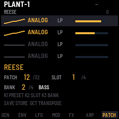

# PLANT-1 firmware for the M-VAVE FM-1

The FM-1 side of [PLANT-1](https://github.com/kong8la/plant1), the browser synth that started it.
This repository builds a real `.fwsc` package you can flash with
[the PLANT-1 flash page](https://kong8la.com/plant1/flash/).

## M6: thirty-two presets



Four banks of eight, each with its own generators, envelopes, effects and matrix:

| Bank | Presets |
| --- | --- |
| **BELLS** | INIT, GLASS BELL, MUSIC BOX, VIBES, CELESTA, TUBULAR, HARP, ICE BELL |
| **BASS** | FM BASS, SUB BASS, ACID, REESE, GROWL, WUB, PLUCK BASS, SQUARE BASS |
| **LEAD** | SUPER SAW, HOOVER, METAL, SYNC, FLUTE, WHISTLE, SOLO, BUZZ |
| **PADS** | PHASE PAD, DARK CHOIR, SWEEP, STRINGS, DRONE, WASH, GLASS PAD, NOISE PAD |

On PATCH: `K1` steps a preset, `K3` jumps a bank, `K2` picks one of the four flash slots, `SAVE`
stores the current sound there.

## M5: an arpeggiator

- patterns UP, DOWN, UPDN, RAND; rates 1/4 to 1/16T; 1-3 octaves; gate 5-95 %
- tap tempo on SEQ (60-200 BPM), the ARP page shows it
- ARP toggles it from any page; held keys are the arp's note pool

## M4: a modulation matrix

- four routes: ENV1 / ENV2 / LFO1 / LFO2 / velocity to any slot's level, cutoff or pitch
- the MOD page (K1 route, K2 source, K3 destination, K4 depth, GLO toggles)
- ENV toggles AMP/MOD, LFO toggles LFO1/LFO2

## M3: an effect chain

- five effect slots: DRIVE, CHORUS, DELAY (139 ms), REVERB, COMP
- an FX page (K1 walks the chain, K2-K4 edit A/B/C, FX toggles)
- four patch slots in flash

## M2: envelopes and LFOs

- ENV page with the curve drawn, LFO page with its shape, patch storage
- a screen that draws each slot's waveform, the envelope and the LFO

## M1: four generators on the device

- 4 generator slots: analog (saw/square/pulse/sine, polyBLEP), wavetable (4 tables, 2 frames,
  morph), FM (ratio/index/feedback), noise (white to pink)
- a TPT state-variable filter per slot (LP/HP/BP/notch), unison 1-3, six voices

## Build

The package is built on GitHub: `.github/workflows/firmware.yml` calls
[zvenson/fm1-build](https://github.com/zvenson/fm1-build), which installs JieLi's Linux toolchain,
clones the AC79 SDK, runs `build.sh`, runs `test.sh`, attests the `.fwsc` and uploads it as the
`packages` artifact.

Local host simulator (any OS, plain `cc`):

```bash
./build.sh --host
app/build/host/plant1m6_host app/tests/basic.txt app/build/host
app/build/host/plant1m6_host app/tests/presets.txt app/build/host
app/build/host/plant1m6_host app/tests/arp.txt app/build/host
app/build/host/plant1m6_host app/tests/mod.txt app/build/host
app/build/host/plant1m6_host app/tests/fx.txt app/build/host
```

The device build needs a Linux host (the toolchain is Linux x86-64 only); `build.sh` and the
Actions workflow are the two supported ways.

## Flash it

1. Download the `packages` artifact from the Actions run (or a release).
2. Open <https://kong8la.com/plant1/flash/> in desktop Chrome or Edge.
3. The page loads the current build by itself; connect the FM-1 over USB and press Install.

The package identity is `FM-1_9600` for M6. The flash page checks the package's SHA-256, its
identity and that it carries the update loader before anything is written.

## Layout

| Path | What |
| --- | --- |
| `app/app.c`, `app/app.h` | the app: engine, presets, modulation, arp, effects, panel, screen, storage |
| `app/fm1.toml` | name, package identity, USB names, licence |
| `app/tests/*.txt` | the host simulator checks (basic, presets, arp, mod, fx, leds, audio) |
| `build.sh` | fetches fm1-base at a pinned commit, runs its `tools/build.py` |
| `test.sh` | the host simulator checks, run by CI |

## Roadmap

- **M0**: one FM voice, ADSR, keys, screen, the build/flash chain proven
- **M1**: 4 generator slots, per-slot filter, unison, 6 voices, panel pages
- **M2**: envelopes with the curve, an LFO, patch storage, a screen that shows the sound
- **M3**: 5-slot effects, an FX page, four flash patch slots
- **M4**: a modulation matrix
- **M5**: an arpeggiator with tap tempo
- **M6** (this): thirty-two presets in four banks
- **M7**: MIDI CC mapping, a step sequencer

## Licences

The app (`app/`) is MIT. fm1-base and felucca-bsp are MPL-2.0 and are not vendored here; `build.sh`
clones them at a pinned commit.
