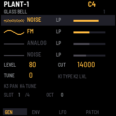

# PLANT-1 firmware for the M-VAVE FM-1

The FM-1 side of [PLANT-1](https://github.com/kong8la/plant1), the browser synth that started it.
This repository builds a real `.fwsc` package you can flash with
[the PLANT-1 flash page](https://kong8la.com/plant1/flash/).

## M2: presets, envelopes and an LFO



- **eight presets**: INIT, GLASS BELL, FM BASS, SUPER SAW, PHASE PAD, PLUCK, ACID, DARK CHOIR
- **four pages**: GEN (slot type, level, pan, tune), ENV (A/D/S/R with the curve drawn),
  LFO (shape, rate, amount, target), PATCH (preset, store)
- **the screen shows the sound**: each slot's waveform, its filter and level, the envelope curve,
  the LFO shape, the note and the voice count
- **patch storage**: SAVE writes the whole patch to flash; it comes back after a power cycle
- **LFO to cutoff or tremolo**, per voice
- **LED animations**: an idle scanner walks the 27 keys, a held key is bright with a fading tail,
  a preset load sweeps the keys, a page change blinks its button, and the octave buttons show their state

```
SEL slot   EDIT page   K1-K4 the page's four values   SAVE store   OCT+/- transpose
```

## M1: four generators on the device

- 4 generator slots: analog (saw/square/pulse/sine, polyBLEP), wavetable (4 tables, 2 frames,
  morph), FM (ratio/index/feedback), noise (white to pink)
- a TPT state-variable filter per slot (LP/HP/BP/notch), unison 1-3, six voices
- identity `FM-1_9100`, release `v0.2.0`

## M0: the chain, and one voice

One FM voice, an ADSR, 27 keys, a screen. The tag `v0.1.0`; it proved the build and flash chain.

## Build

The package is built on GitHub: `.github/workflows/firmware.yml` calls
[zvenson/fm1-build](https://github.com/zvenson/fm1-build), which installs JieLi's Linux toolchain,
clones the AC79 SDK, runs `build.sh`, runs `test.sh`, attests the `.fwsc` and uploads it as the
`packages` artifact.

Local host simulator (any OS, plain `cc`):

```bash
./build.sh --host
app/build/host/plant1m2_host app/tests/basic.txt app/build/host
```

The device build needs a Linux host (the toolchain is Linux x86-64 only); `build.sh` and the
Actions workflow are the two supported ways.

## Flash it

1. Download the `packages` artifact from the Actions run (or a release).
2. Open <https://kong8la.com/plant1/flash/> in desktop Chrome or Edge.
3. The page loads the current build by itself; connect the FM-1 over USB and press Install.

The package identity is `FM-1_9200` for M2. The flash page checks the package's SHA-256, its
identity and that it carries the update loader before anything is written.

## Layout

| Path | What |
| --- | --- |
| `app/app.c`, `app/app.h` | the app: engine, presets, panel, screen, storage |
| `app/fm1.toml` | name, package identity, USB names, licence |
| `app/tests/basic.txt` | host simulator checks: keys, slots, pages, presets, slot type |
| `app/tests/audio.txt` | renders a note to `note.wav` in the host |
| `build.sh` | fetches fm1-base at a pinned commit, runs its `tools/build.py` |
| `test.sh` | the host simulator checks, run by CI |

## Roadmap

- **M0**: one FM voice, ADSR, keys, screen, the build/flash chain proven
- **M1**: 4 generator slots, per-slot filter, unison, 6 voices, panel pages
- **M2** (this): presets, envelopes with the curve, an LFO, patch storage, a screen that shows the sound
- **M3**: 5-slot effects (drive, chorus, delay, reverb), more presets, the full PLANT-1 panel

## Licences

The app (`app/`) is MIT. fm1-base and felucca-bsp are MPL-2.0 and are not vendored here; `build.sh`
clones them at a pinned commit.
