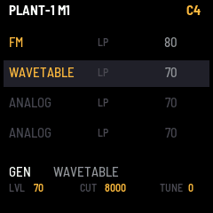

# PLANT-1 firmware for the M-VAVE FM-1

The FM-1 side of [PLANT-1](https://github.com/kong8la/plant1), the browser synth that started it.
This repository builds a real `.fwsc` package you can flash with
[the PLANT-1 flash page](https://kong8la.com/plant1/flash/).

## M1: four generators on the device



- **4 generator slots**, each: analog (saw / square / pulse / sine, polyBLEP), wavetable
  (4 tables, 2 frames, morph), FM (ratio / index / feedback) or noise (white to pink)
- **a TPT state-variable filter per slot** (LP / HP / BP / notch, cutoff, resonance)
- **unison** 1-3 with detune and spread, **6 voices**, oldest stolen
- **one ADSR** shared by the voices (4 ms / 260 ms / 0.55 / 220 ms)
- **the panel**: SEL picks a slot, EDIT cycles GEN / FILTER / VOICE, K1-K4 edit that page,
  OCT+/- and HOME as labelled; the screen shows the four slots, the selected one lit,
  and the current page's values

The default patch is M0's FM voice (ratio 2, index 3.2) on slot 1; the other three start off and are
turned on with K1.

```
key 7 -> C4    SEL -> slot 2    K1 -> ANALOG    EDIT -> FILTER    K2 -> cutoff
```

## M0: the chain, and one voice

M0 proved the pipeline: one FM voice, one ADSR, the 27 keys, a 240x240 screen. It is the tag
`v0.1.0` in this repository; M1 is the current source.

## Build

The package is built on GitHub: `.github/workflows/firmware.yml` calls
[zvenson/fm1-build](https://github.com/zvenson/fm1-build), which installs JieLi's Linux toolchain,
clones the AC79 SDK, runs `build.sh`, runs `test.sh`, attests the `.fwsc` and uploads it as the
`packages` artifact.

Local host simulator (any OS, plain `cc`):

```bash
./build.sh --host                      # builds base/ if it is not there, then the host binary
app/build/host/plant1m1_host app/tests/basic.txt app/build/host
```

The device build needs a Linux host (the toolchain is Linux x86-64 only); `build.sh` and the
Actions workflow are the two supported ways.

## Flash it

1. Download the `packages` artifact from the Actions run (or a release).
2. Open <https://kong8la.com/plant1/flash/> in desktop Chrome or Edge.
3. Pick the `.fwsc`, connect the FM-1 over USB, write.

The package identity is `FM-1_9100` for M1 (`FM-1_9000` for M0). The flash page checks the
package's SHA-256, its identity and that it carries the update loader before anything is written.

## Layout

| Path | What |
| --- | --- |
| `app/app.c`, `app/app.h` | the app: engine, panel, screen |
| `app/fm1.toml` | name, package identity, USB names, licence |
| `app/tests/basic.txt` | host simulator checks: keys, SEL, EDIT, K1 |
| `app/tests/audio.txt` | renders a note to `note.wav` in the host |
| `build.sh` | fetches fm1-base at a pinned commit, runs its `tools/build.py` |
| `test.sh` | the host simulator checks, run by CI |

## Roadmap

- **M0**: one FM voice, ADSR, keys, screen, the build/flash chain proven
- **M1** (this): 4 generator slots, per-slot filter, unison, 6 voices, panel pages
- **M2**: 3 envelopes, 2 LFOs, chaos, the modulation matrix
- **M3**: 5-slot effects, patch storage, presets, the full PLANT-1 panel

The browser version stays the reference for the engine and the patches; each M is a straight port
of one part of it to C, checked in the host simulator before it goes on the device.

## Licences

The app (`app/`) is MIT. fm1-base and felucca-bsp are MPL-2.0 and are not vendored here; `build.sh`
clones them at a pinned commit.
