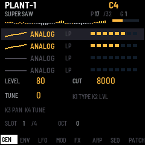
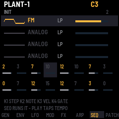

# PLANT-1 firmware for the M-VAVE FM-1

The FM-1 side of [PLANT-1](https://github.com/kong8la/plant1), the browser synth that started it.
This repository builds a real `.fwsc` package you can flash with
[the PLANT-1 flash page](https://kong8la.com/plant1/flash/).

## M11: the panel, after JIANT

The control scheme follows the one JIANT FM documents (its manual, not its code): a section button
takes you to that section, pressing it again walks the section's groups, and holding it runs that
section's action.

| Button | tap | tap again (inside) | hold |
| --- | --- | --- | --- |
| HOME | GEN | - | **panic: all notes off** |
| ENV | ENV | AMP / MOD | - |
| LFO | LFO | LFO1 / LFO2 | - |
| FX | FX | next effect | **toggle that effect** |
| GLO | MOD | next route | **toggle that route** |
| ARP | ARP | start/stop | start/stop |
| SEQ | SEQ | start/stop | start/stop |
| SAVE | PATCH | next slot | **store the patch** |
| SEL | next slot | - | - |
| EDIT | next page | - | - |
| PLAY | transport | - | **panic** |
| REC | tap tempo (twice) | - | - |
| OCT+/- | transpose | - | - |

The three fixed encoders keep one job each: **SELECT** walks the pages, **ALGORITHM** picks the slot,
**PRESETS** always picks the sound; K1-K4 are the page's four values. The screen prints which one
just moved (PAGE / SLOT / PRESET / PANIC / SAVE).
## M10: the screen



- an **oscilloscope** of the output in the header, with a peak meter
- the four slots as **cards** with segmented level meters and their waveform
- a **lit pill** on the current page tab, and a bright bar that sweeps across the page when it changes
- the header keeps the patch number and slot (P 12/32 G 2); PRESET / SELECT / ALGO print what they did
## M8: the panel, wired to the sound



Every button does its label; pressing a page button twice toggles that page's switch.

| Button | Does |
| --- | --- |
| FX | jump to FX, then toggle the selected effect |
| SEL | next generator slot |
| ENV | jump to ENV, then toggle AMP / MOD |
| LFO | jump to LFO, then toggle LFO1 / LFO2 |
| EDIT | next page |
| GLO | jump to MOD, then toggle the selected route |
| HOME | back to GEN and stop everything |
| SAVE | store the patch in the current flash slot |
| ARP | jump to ARP, then start/stop the arp |
| SEQ | jump to SEQ, then start/stop the sequencer |
| PLAY | transport: start the sequencer, or stop whatever runs |
| REC | tap tempo (press twice) |
| OCT+ / OCT- | transpose |

All seven encoders work: **PRESET** steps the 32 presets, **SELECT** the slot, **ALGO** the page,
and **K1-K4** edit the current page's four values.

Voices are declicked when a slot is reused (their envelope and filter state are kept), and the
output is soft-saturated, so the sequencer and the arp do not click or clip.

## M7: a sixteen-step sequencer

- 16 steps, each with note above the held key, velocity, gate and on/off
- SEQ runs it, PLAY taps tempo; the SEQ page edits step / note / velocity / gate

## M6: thirty-two presets

Four banks of eight: BELLS, BASS, LEAD, PADS. PATCH page: K1 steps, K3 jumps a bank, K2 picks a
flash slot, SAVE stores.

## M5: an arpeggiator

Patterns UP / DOWN / UPDN / RAND, rates 1/4 to 1/16T, 1-3 octaves, gate, tap tempo.

## M4: a modulation matrix

Four routes: ENV1 / ENV2 / LFO1 / LFO2 / velocity to any slot's level, cutoff or pitch.

## M3: an effect chain

DRIVE, CHORUS, DELAY (139 ms), REVERB, COMP, with an FX page and four flash patch slots.

## M2: envelopes and LFOs

Two envelopes with their curves, two LFOs with their shapes, patch storage.

## M1: four generators on the device

Analog (saw/square/pulse/sine), wavetable (4 tables, 2 frames, morph), FM (ratio/index/feedback),
noise; a TPT filter per slot, unison 1-3, six voices.

## Build

The package is built on GitHub: `.github/workflows/firmware.yml` calls
[zvenson/fm1-build](https://github.com/zvenson/fm1-build), which installs JieLi's Linux toolchain,
clones the AC79 SDK, runs `build.sh`, runs `test.sh`, attests the `.fwsc` and uploads it as the
`packages` artifact.

Local host simulator (any OS, plain `cc`):

```bash
./build.sh --host
app/build/host/plant1m8_host app/tests/panel.txt app/build/host
app/build/host/plant1m8_host app/tests/seq.txt app/build/host
app/build/host/plant1m8_host app/tests/arp.txt app/build/host
app/build/host/plant1m8_host app/tests/presets.txt app/build/host
```

The device build needs a Linux host (the toolchain is Linux x86-64 only); `build.sh` and the
Actions workflow are the two supported ways.

## Flash it

1. Download the `packages` artifact from the Actions run (or a release).
2. Open <https://kong8la.com/plant1/flash/> in desktop Chrome or Edge.
3. The page loads the current build by itself; connect the FM-1 over USB and press Install.

The package identity is `FM-1_9800` for M8.

## Layout

| Path | What |
| --- | --- |
| `app/app.c`, `app/app.h` | the app: engine, presets, modulation, arp, seq, effects, panel, screen, storage |
| `app/fm1.toml` | name, package identity, USB names, licence |
| `app/tests/*.txt` | the host simulator checks (panel, basic, seq, arp, mod, fx, presets, leds, audio) |
| `build.sh` | fetches fm1-base at a pinned commit, runs its `tools/build.py` |
| `test.sh` | the host simulator checks, run by CI |

## Licences

The app (`app/`) is MIT. fm1-base and felucca-bsp are MPL-2.0 and are not vendored here; `build.sh`
clones them at a pinned commit.
