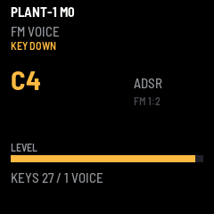

# PLANT-1 firmware for the M-VAVE FM-1

The FM-1 side of [PLANT-1](https://github.com/kong8la/plant1) — the browser synth that started it.
This repository builds a real `.fwsc` package you can flash with
[the PLANT-1 flash page](https://kong8la.com/plant1/flash/).

## M0 — the whole chain, and one voice

M0 exists to prove the pipeline, not to sound good yet:

- one FM voice (carrier + modulator, ratio 2, index 3.2)
- one ADSR (4 ms / 260 ms / 0.55 / 220 ms)
- the 27 keys, lowest held key wins (mono), key LEDs follow
- a 240×240 screen: name, note, level bar



```
key 7 → C4 · key released → silent
```

## Build

Local (needs a Linux host for the JieLi toolchain; the host simulator runs anywhere):

```bash
base/tools/build.py app --host        # the host simulator, after ./build.sh fetched base/
app/build/host/plant1m0_host app/tests/basic.txt app/build/host
```

The package is built on GitHub:

```bash
git push                # .github/workflows/firmware.yml → zvenson/fm1-build
```

It downloads the JieLi Linux toolchain and the AC79 SDK, runs `./build.sh`, runs `./test.sh`,
attests `app/build/*.fwsc` and uploads it as the `packages` artifact.

## Flash it

1. Download the `packages` artifact from the Actions run (or a release).
2. Open <https://kong8la.com/plant1/flash/> in desktop Chrome or Edge.
3. Pick the `.fwsc`, connect the FM-1 over USB, write.

The package identity is `FM-1_9000` (dev builds). The flash page checks the package's
SHA-256, its identity and that it carries the update loader before anything is written.

## Layout

| Path | What |
| --- | --- |
| `app/app.c`, `app/app.h` | the app: engine, input, screen |
| `app/fm1.toml` | name, package identity, USB names, licence |
| `app/tests/basic.txt` | host simulator checks |
| `build.sh` | fetches fm1-base at a pinned commit, runs its `tools/build.py` |
| `test.sh` | the host simulator checks, run by CI |

## Roadmap

- **M0** (this): one FM voice, ADSR, keys, screen, the build/flash chain proven
- **M1**: 4 generator slots (analog, wavetable, FM, noise), per-slot filter, unison
- **M2**: envelopes, LFOs, chaos, the modulation matrix
- **M3**: 5-slot effects, patch storage, the full PLANT-1 panel

The browser version stays the reference for the engine and the patches; each M is a straight port
of one part of it to C, checked in the host simulator before it goes on the device.

## Licences

The app (`app/`) is MIT. fm1-base and felucca-bsp are MPL-2.0 and are not vendored here; `build.sh`
clones them at a pinned commit.
